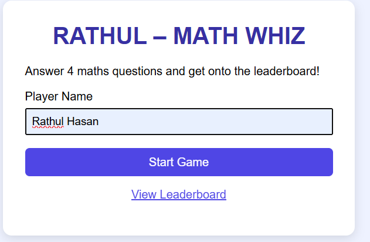
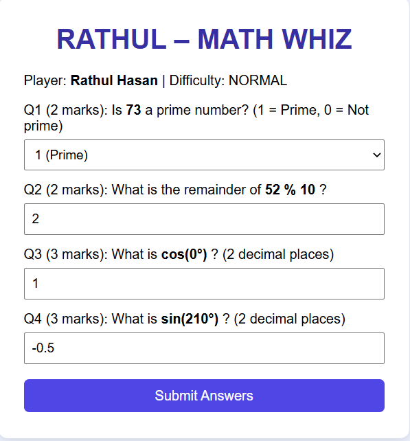
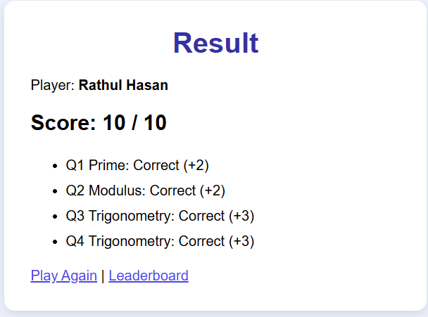
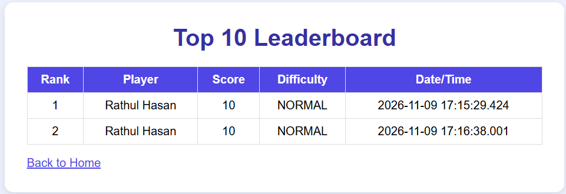

# RATHUL – MATH WHIZ

A web-based mathematical game built with **Java Servlet, JSP and JDBC (PostgreSQL)**. The player enters a name, answers four maths questions (prime number, modulus and two trigonometry questions), sees the final score out of 10, and the result is saved to a database. A leaderboard shows the top 10 scores.

> Replace "RATHUL" in the title (`index.jsp`, `game.jsp`) and in this README if you want a different display name.

## Project Objectives

- Write reusable Java methods for prime, modulus and trigonometric calculations.
- Process requests and responses with a Java Servlet.
- Connect to PostgreSQL with JDBC and use `PreparedStatement`.
- Save scores and display a sorted top-10 leaderboard.
- Document and submit a complete project on GitHub.

## Technologies Used

- Java 17
- Jakarta Servlet 6.0 and JSP, Jakarta JSTL 3.0
- JDBC with PostgreSQL JDBC Driver 42
- PostgreSQL
- Maven (WAR packaging)
- Apache Tomcat 10.1
- HTML and CSS

## Software Requirements

- JDK 17 (or 11, change `maven.compiler.source/target` in `pom.xml`)
- Apache Tomcat 10.1.x (Jakarta Servlet 6 / `jakarta.*` namespace)
- PostgreSQL 14+ (with pgAdmin)
- Maven (or an IDE with built-in Maven)
- Git

## Database Configuration

1. Make sure the PostgreSQL service is running.
2. Open pgAdmin (or psql) and run `CREATE DATABASE math_whiz_db;`.
3. Connect to `math_whiz_db` (pgAdmin: select it, then Tools → Query Tool) and run the table SQL below (also in `database/math_whiz_db.sql`).
4. Open `src/main/java/dao/ScoreDAO.java` and set your credentials:

```java
private static final String URL = "jdbc:postgresql://localhost:5432/math_whiz_db";
private static final String USER = "postgres";
private static final String PASSWORD = "your_password";
```

### Database Creation SQL

```sql
CREATE DATABASE math_whiz_db;

-- connect to math_whiz_db, then:
CREATE TABLE IF NOT EXISTS game_scores (
  id          SERIAL PRIMARY KEY,
  player_name VARCHAR(100) NOT NULL,
  score       INT          NOT NULL,
  difficulty  VARCHAR(20)  NOT NULL,
  played_at   TIMESTAMP    DEFAULT CURRENT_TIMESTAMP
);
```

## Steps to Run the Application

1. Clone the repository and open the `MathWhiz` folder.
2. Create the database (see above) and set the DB password in `ScoreDAO.java`.
3. Build the WAR file:
   ```
   mvn clean package
   ```
   (In IntelliJ: Maven panel → Lifecycle → package.)
4. Copy `target/MathWhiz.war` into Tomcat's `webapps/` folder.
5. Start Tomcat (`bin/startup.bat` on Windows, `bin/startup.sh` on Linux/Mac).
6. Open `http://localhost:8080/MathWhiz/` in the browser.

**Note:** this project uses the `jakarta.*` namespace, so it needs Tomcat 10.1 or newer. For Tomcat 9, replace `jakarta.servlet` with `javax.servlet`, use `javax.servlet-api 4.0.1` and `jstl 1.2` in `pom.xml`, and set the JSTL URI in the JSPs to `http://java.sun.com/jsp/jstl/core`.

## Project Structure

```
MathWhiz/
├── pom.xml
├── database/math_whiz_db.sql
├── README.md
├── screenshots/
└── src/main/
    ├── java/
    │   ├── controller/GameServlet.java
    │   ├── model/GameScore.java
    │   ├── service/MathService.java
    │   ├── service/MathServiceTest.java
    │   └── dao/ScoreDAO.java
    └── webapp/
        ├── index.jsp
        ├── game.jsp
        ├── result.jsp
        ├── leaderboard.jsp
        └── css/style.css
```

## Game Rules and Scoring System

| Question | Area | Marks |
|---|---|---|
| Q1 | Prime number (1 = prime, 0 = not prime) | 2 |
| Q2 | Modulus (integers only, divisor is never 0) | 2 |
| Q3 | Trigonometry (sin / cos / tan) | 3 |
| Q4 | Trigonometry (sin / cos / tan) | 3 |
| **Total** | | **10** |

- Difficulty is `NORMAL` for all questions and is stored in the database.
- Angles are in degrees and converted to radians with `Math.toRadians()` before `Math.sin()`, `Math.cos()` or `Math.tan()`.
- Decimal answers are accepted within a tolerance of 0.01.
- Questions are generated randomly on the server and stored in the session. Correct answers are calculated by the Java methods in `MathService` at submit time, never stored or sent to the browser.
- Undefined tangent angles (90°, 270°) are never asked, and `calculateTan` throws an exception for them.
- Leaderboard: `ORDER BY score DESC, played_at ASC LIMIT 10` (earlier time wins a tie).

## Testing

Run `service/MathServiceTest.java` (right click → Run) to check the maths methods.

| Test Case | Expected |
|---|---|
| Prime 7 | 1 |
| Prime 8 | 0 |
| Prime 1 | 0 |
| 17 % 5 | 2 |
| sin 30° | 0.5 |
| cos 60° | 0.5 |
| tan 45° | 1.0 |
| Divisor 0 | Validation error |
| All answers correct | 10 marks |
| Wrong answers | Marks not awarded |

## Application Screenshots

### Welcome Page


### Game Page


### Result Page


### Leaderboard


## GitHub Project Directory Link

 https://github.com/rathul85/java-web-lab
